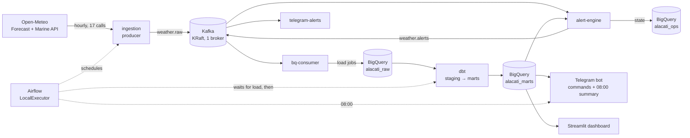

# alacati-hava — Çeşme Peninsula Weather Platform

Hourly weather data for the Çeşme peninsula (İzmir, Türkiye), turned into three things
locals and visitors actually ask about:

1. **Severe weather alerts** — thunderstorms, heavy rain, strong wind and high waves,
   with yellow / orange / red levels and a proper lifecycle: one message when an event
   is first seen, one when it changes, one when it is over. No repeats.
2. **Beach recommendation** — which beach is most sheltered from today's wind.
3. **Surf / kite windows** — when the wind at Alaçatı enters a rideable range.

Delivered through a **Telegram bot** (08:00 morning summary, instant alerts, `/uyari`,
`/plaj`, `/ruzgar`) and a **Streamlit dashboard**.

> Personal, non-commercial portfolio project. Based on model forecasts — for official
> warnings see the Turkish State Meteorological Service ([MGM](https://mgm.gov.tr)).
> Weather data by [Open-Meteo.com](https://open-meteo.com) (CC BY 4.0).

**Live dashboard:** <https://alacati-hava.streamlit.app> (Streamlit Community Cloud, read-only
service account limited to the mart tables) · **Telegram channel:** <https://t.me/alacatihava>
· **Bot:** <https://t.me/alacati_hava_bot>

The dashboard keeps working when the laptop "server" is off; it then shows the last data
that was loaded (the page shows the time of the last update).

---

## Architecture



| Layer | What runs | Notes |
|---|---|---|
| Ingestion | `ingestion/` — Open-Meteo client + Kafka producer | Retries, unit checks, rate limit, daily call budget, every call logged to `alacati_ops.api_call_log`. Catches up missed hours after downtime via `past_hours`. |
| Streaming | `streaming/` — `bq-consumer`, `alert-engine` | Offsets are committed only after the side effect succeeded (at-least-once); deterministic BigQuery job ids and notification ids make replays harmless. |
| Warehouse | BigQuery (EU) | Batch load jobs only (no streaming inserts), tables partitioned by date and clustered by location. |
| Transformations | `dbt/` | Staging → marts with **enforced model contracts**, 52 data tests and 11 unit tests. Alert rules and the beach score are SQL. |
| Orchestration | `orchestration/` — Airflow 3 | `weather_hourly` (ingest → wait until loaded → dbt build → freshness), `morning_summary`, weekly maintenance, Telegram message on failure. |
| Apps | `apps/telegram_bot/`, `apps/streamlit/` | Read only the small mart tables. Turkish UI. |

### An honest note on scale

The whole dataset is ~1,300 rows per hour. **Kafka and Airflow are not needed at this
size** — a cron job and a Python script would do. They are here on purpose, to show how
the same pipeline is built when it has to be reliable and replayable: data contracts,
idempotent loads, consumer offsets committed after the write, a separate alert-state
store, failure notifications and recovery after the "server" (a laptop) reboots.

## Data contracts first

Everything starts in [`contracts/`](contracts/README.md), written and reviewed before any
component:

- **Kafka** — JSON Schemas for `weather.raw` (one Open-Meteo response) and
  `weather.alerts` (one alert lifecycle change), validated by producers and consumers.
- **BigQuery** — every raw, ops and mart table with grain, unique key, partitioning and
  clustering ([`tables.yaml`](contracts/bigquery/tables.yaml)). The raw/ops tables are
  created from these files; the marts enforce them through dbt model contracts.

All thresholds and parameters live in [`config/`](config/) (YAML), never in code.

## How alerts work

1. dbt computes, for every location and forecast hour, the highest level any rule reaches
   (gusts, mean wind, hourly and 6-hour rain, thunderstorm codes with CAPE escalation,
   wave height), then merges flagged hours into peninsula-wide **episodes** with
   per-region levels ([`config/alerts.yaml`](config/alerts.yaml) documents the algorithm).
2. The **alert engine** compares each complete run's episodes with what was last
   *notified* and decides `new` / `updated` (level change, window shift > 3 h, new region)
   / `ended` (window passed, or absent for 2 consecutive runs — hysteresis against
   flapping). Downgrades need two runs to confirm.
3. Notifications go through `weather.alerts` to the bot, which skips anything already
   delivered or older than two hours.

Tested end to end by temporarily lowering a threshold: three `new` alerts, no repeat on
the next run, nothing on the first run without the event, three `ended` on the second.

## Running it

**Prerequisites:** Python 3.12 + [uv](https://docs.astral.sh/uv/), Docker Desktop, a
Google Cloud project with BigQuery, `gcloud` CLI, a Telegram bot token from @BotFather.

```bash
cp .env.example .env                        # fill in project id, Telegram, Airflow secrets
gcloud auth application-default login       # local credentials (mounted read-only in Docker)
cd ingestion && uv run alacati-ingest setup # create raw + ops tables from the contracts
cd .. && docker compose up -d --build       # Kafka, Airflow, consumers, alert engine, bot
```

Airflow UI: <http://localhost:8080>. Running the "server" on a Windows laptop (autostart,
power settings, recovery after reboot, Kafka lag and replay) is described in
[`docs/laptop-server.md`](docs/laptop-server.md).

Individual components without Docker:

```bash
cd ingestion && uv run alacati-ingest run --sink bigquery   # one ingestion run
cd dbt && uv run python run_dbt.py build                    # config/*.yaml passed as dbt vars
cd apps/streamlit && uv run streamlit run app.py            # dashboard on localhost:8501
```

## Tests and quality gates

| Component | Tests |
|---|---|
| contracts + config consistency | 30 |
| ingestion | 48 |
| streaming (incl. alert lifecycle) | 52 |
| Telegram bot | 58 |
| Streamlit | 31 |
| dbt | 52 data tests + 11 unit tests |

ruff and mypy (strict) on the Python packages; gitleaks + hygiene hooks in pre-commit and
in CI ([`.github/workflows/ci.yml`](.github/workflows/ci.yml)). Every phase was reviewed
by a separate code-review pass before it was approved.

## Limitations

- **Model data, coarse grids.** The 13 points fall into 5 forecast grid cells; beaches in
  the same cell get the same wind and are ranked by their orientation. Waves come from
  four open-sea cells (~9 km grid), so sheltered bays usually see less than reported.
- **Unverified locations.** Beach coordinates and shore orientations are drafts marked
  `verified: false` until checked locally.
- **At-least-once delivery.** Ids are deterministic and deliveries are de-duplicated, but
  a crash at an unlucky moment can still produce a rare duplicate Telegram message.
- **Stale alerts are dropped.** The bot ignores alert notifications older than two hours,
  so if the bot itself is down longer than that, those messages are skipped (the current
  state is still visible via `/uyari` and the dashboard).
- **Laptop server.** Single broker, replication factor 1, local gcloud credentials —
  fine for a portfolio, not for production (use a service account and managed services).

## Repository layout

```
contracts/      data contracts (Kafka JSON Schema, BigQuery schemas)
config/         locations, alert thresholds, surf, beach score, bot (YAML)
ingestion/      Open-Meteo client, BigQuery loader, Kafka producer
streaming/      Kafka consumers: BigQuery loader, alert engine
dbt/            staging → marts, tests
orchestration/  Airflow DAGs
apps/           telegram_bot/, streamlit/
docker/         Dockerfiles
docs/           operations notes
```

## Attribution

Weather data by [Open-Meteo.com](https://open-meteo.com), licensed under
[CC BY 4.0](https://creativecommons.org/licenses/by/4.0/). Usage stays far below the free
non-commercial limit (~410 calls/day, counted and logged).
